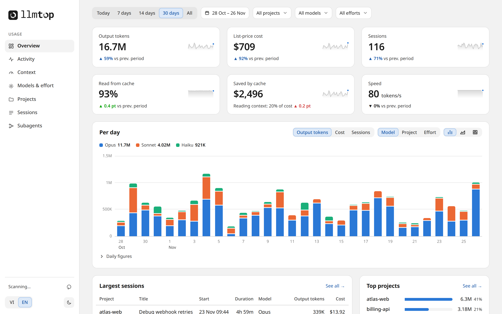
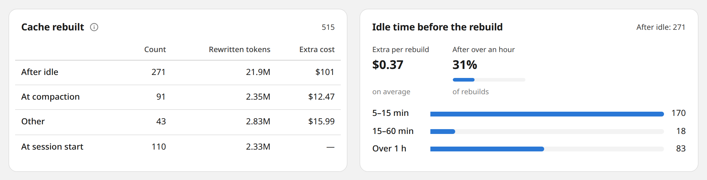
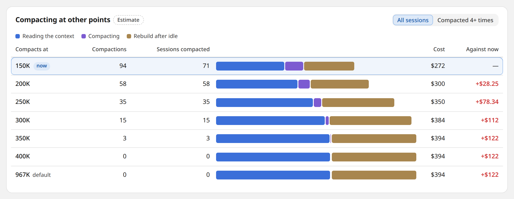
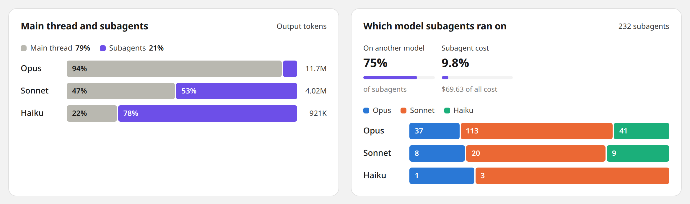

<div align="center">

<picture>
  <source media="(prefers-color-scheme: dark)" srcset="docs/brand/svg/llmtop-lockup-reversed.svg">
  
</picture>

**Local usage and cost analytics for Claude Code, Codex and Antigravity**

_Transcripts are archived into SQLite and priced on your own machine. The server binds to `127.0.0.1` only, and neither the server nor the dashboard makes a network request._

[](#license)
[](package.json)
[](https://github.com/nguyencanhtrung/llmtop/commits/main)

[Quickstart](#quickstart) · [Features](#features) · [Commands](#commands) · [Docs](#documentation) · [License](#license)

<picture>
  <source media="(prefers-color-scheme: dark)" srcset="docs/assets/overview-dark.png">
  
</picture>

<sub>Every figure in these screenshots is synthetic demo data served by <code>make demo</code>.</sub>

</div>

## Overview

llmtop is a local dashboard and CLI for developers using AI coding agents. It archives local transcripts from Claude Code (`~/.claude/projects`), Codex (`~/.codex/sessions`) and Antigravity CLI (`~/.gemini/antigravity-cli`), ingests them into SQLite through `node:sqlite`, and prices every request against [prices.md](prices.md). Providers with no local transcripts are skipped automatically. Seven views and a matching CLI answer what summary totals hide: which repository costs the most, which sessions ran long, which models and subagents did the work, why the prompt cache rebuilt, and what carrying long context costs.

Nothing leaves your machine. The HTTP server binds to `127.0.0.1` only, and neither the server nor the browser app makes any outbound network request. The `data/` directory is ignored by Git: `data/archive/<provider>/` keeps an append-only copy of each transcript so history survives host deletion, while `data/usage.db` is disposable and rebuilt from the archive whenever the schema changes. Cost figures use list prices from [prices.md](prices.md); on a subscription plan, cost represents quota spent rather than direct billing.

## Features

- **Multi-provider transcript archiving.** Reads Claude Code, Codex and Antigravity CLI transcripts into append-only zstd-compressed frames under `data/archive/<provider>/`, keeping line numbers stable so `session:line` references never drift even if the host removes old files.
- **Prompt cache rebuild analysis.** Tracks every cache rebuild, its extra write cost compared to reading, and its cause: session start, compaction, idle break past the cache lifetime (`5–15m`, `15–60m`, `>1h`), or other.
- **Context and compaction replay.** Measures what each compaction costs, breaks down context-reading cost by carried context size, and replays main conversations counterfactually to compare compaction thresholds.
- **Project cost treemap.** Groups sessions by repository (nearest `.git` directory above the session working directory, or folder name fallback) and sizes tiles by cost.
- **Model and subagent breakdown.** Reports output and thinking tokens per request, requests per owner turn, tool calls and failure share, output speed, effort-level cost, and the share of work delegated to subagents by model.
- **Sortable session explorer.** Lists every conversation with its title, length, model, cost, and cache lapse count.
- **Matching CLI and dashboard.** Provides `scan`, `show`, `usage`, `prices`, and `serve` (with `--json` on listing commands). For the same window and filters, `usage` and the dashboard report identical totals.
- **Bilingual local dashboard.** Built with Vite, React and TypeScript with automatic light/dark themes, English and Vietnamese UI strings, and zero external runtime dependencies beyond React and Node's built-in `node:sqlite`.
- **Private by default.** Serves exclusively on `127.0.0.1` with no telemetry, remote API calls, or asset CDNs.

<p align="center">
  <picture>
    <source media="(prefers-color-scheme: dark)" srcset="docs/assets/cache-dark.png">
    
  </picture>
  <br>
  <sub>Cache rebuilds by cause and extra cost.</sub>
</p>

<p align="center">
  <picture>
    <source media="(prefers-color-scheme: dark)" srcset="docs/assets/context-dark.png">
    
  </picture>
  <br>
  <sub>Compaction cost and counterfactual context replay across compaction points.</sub>
</p>

<p align="center">
  <picture>
    <source media="(prefers-color-scheme: dark)" srcset="docs/assets/treemap-dark.png">
    
  </picture>
  <br>
  <sub>Repository cost share treemap.</sub>
</p>

<p align="center">
  <picture>
    <source media="(prefers-color-scheme: dark)" srcset="docs/assets/models-dark.png">
    
  </picture>
  <br>
  <sub>Main thread and subagent output by model.</sub>
</p>

<p align="center">
  <picture>
    <source media="(prefers-color-scheme: dark)" srcset="docs/assets/sessions-dark.png">
    
  </picture>
  <br>
  <sub>Sortable sessions table with length, model, cost and cache lapses.</sub>
</p>

## Prerequisites

- **Node.js 25 or later** (required by [package.json](package.json) for built-in `node:sqlite` and zstd support) and **npm**
- **Local agent transcripts** from at least one supported tool (`~/.claude/projects`, `~/.codex/sessions`, or `~/.gemini/antigravity-cli`); optional if previewing with `make demo`
- Optional: **`make`** for convenience targets (every workflow also runs directly via `npm` and `node`)
- Optional: **Google Chrome or Chromium** only if regenerating README screenshots with `make screenshots` (set `CHROME` to override the binary path)

## Quickstart

```bash
git clone https://github.com/nguyencanhtrung/llmtop.git
cd llmtop
make start
```

`make start` installs dependencies via `npm ci` when needed, builds `dashboard/dist`, starts the server in the background on `http://localhost:4310` (bound to `127.0.0.1`, PID in `data/serve.pid`, output in `data/serve.log`), and returns once ready. Stop it anytime with `make stop`.

Open <http://localhost:4310>. Your first visit scans local transcripts into `data/`; use the Refresh button in the sidebar footer to scan again. Without `make`, run `npm install` then `npm start` (serves in the foreground until `Ctrl+C`).

To explore ten weeks of synthetic usage data without scanning your local transcripts, run `make demo` and open <http://localhost:4311>.

## Commands

| `make` target | Equivalent command | What it does |
| --- | --- | --- |
| `make start` | `npm start` | Build the dashboard and serve it (in the background via `make start`; foreground via `npm start`) |
| `make stop` | | Stop the background server started by `make start` |
| `make dev` | `npm run dev` | Serve the dashboard with Vite hot reload in the foreground |
| `make demo` | `node test/fixtures/demo.mjs` | Serve ten weeks of synthetic demo data at `http://localhost:4311` |
| `make scan` | `node bin/llmtop.mjs scan` | Archive new transcript lines and ingest them into `data/usage.db` |
| `make usage DAYS=30 BY=model` | `node bin/llmtop.mjs usage --days 30 --by model` | Show tokens and cost in the terminal; `ARGS="..."` passes extra flags |
| `make prices` | `node bin/llmtop.mjs prices` | Check [prices.md](prices.md) against host-recorded session costs |
| `make test` | `npm test` | Run the `node --test` suite on synthetic data |
| `make check` | `npm run check` | Type-check `dashboard/` with TypeScript |
| `make build` | `npm run build` | Type-check and build `dashboard/dist` |

Run `make` alone to list targets. Full CLI reference:

```text
node bin/llmtop.mjs scan                                  archive new transcript lines and ingest them
node bin/llmtop.mjs show <session>:<line>                 print one archived record
node bin/llmtop.mjs usage [--days n | --since d --until d] [--by day|model|provider|effort|project|session|hour|tool|skill|subagent]
                          [--provider name] [--project name] [--model family] [--effort level]
node bin/llmtop.mjs prices                                the price table checked against the host's cost records
node bin/llmtop.mjs serve [--port n]                      the built dashboard on http://localhost:<port>
```

Listing commands accept `--json`. For one window and one set of filters, `usage` and the dashboard report the same totals.

## How it works

<details>
<summary><strong>Where data lives</strong></summary>

```text
data/
├── archive/
│   ├── claude/     append-only .jsonl.zst frames, line numbers stable
│   ├── codex/      append-only .jsonl.zst frames + session_index.jsonl
│   └── agy/        append-only .jsonl.zst frames
└── usage.db        SQLite database rebuilt from archive on schema changes
```

The archive preserves transcripts even if the host tool later deletes them. `data/` is gitignored; deleting `data/usage.db` is safe and the next scan rebuilds it from `data/archive/`.

A session's project is resolved to the nearest directory at or above its working directory containing `.git`; if none exists, the directory's own name is used.

</details>

<details>
<summary><strong>How cost is computed</strong></summary>

When a host records session cost, llmtop preserves that total and spreads it across the session's requests weighted by their token counts priced on their date from [prices.md](prices.md) (USD per million tokens, effective from each row's `from` date until a later row for the same model). Sessions without a host cost record are estimated from [prices.md](prices.md) and marked as estimated. `prices` and the scan report highlight mismatches between host cost records and the table; append a new dated row when a price changes rather than editing historical rows.

Each request cost is split into context reads, cache writes, output, and web search. Background calls not written to transcripts (such as Haiku calls for `WebSearch`) are split using host-recorded per-model token totals; web search covers cost above token prices on models that ran web searches. Models missing from [prices.md](prices.md) remain `"Not split"`.

Cache savings compare each request's bill without the prompt cache (cache reads priced as uncached input) against the actual bill including cache write premiums. Because raw savings scale with total volume, the Overview compares periods using the share of cost spent reading context instead, where a rise indicates worse cache efficiency.

</details>

<details>
<summary><strong>Cache rebuilds</strong></summary>

Prompt caches make reading prior context cheap, while rebuilding the cache writes most of the context again at a much higher rate. llmtop flags a request as a rebuild when it writes at least 20,000 tokens to the cache and more than half of all tokens it read or wrote, or when it is the first request of a thread after a compaction and writes at least 20,000 tokens. The Activity view and `usage` group rebuilds by cause:

| Cause | Meaning |
| --- | --- |
| At session start | First request of a thread (main conversation or subagent); unavoidable |
| At compaction | A compaction occurred since the thread's previous request |
| After idle | Gap since the previous request exceeded cache lifetime (`1h` if the latest write used 1h cache, else `5m`; bucketed as `5–15m`, `15–60m`, `>1h`) |
| Other | Any other rebuild not explained by the causes above |

Extra rebuild cost equals the rewritten tokens priced as cache writes (`5m` and `1h` as recorded, defaulting unsplit writes to `1h`) minus the same tokens priced as cache reads. The Sessions view surfaces idle rebuild counts per session as cache lapses. The `20,000`-token and `50%` thresholds are fixed conventions rather than host-reported events; models without a price row count rebuilds without an extra-cost figure.

</details>

<details>
<summary><strong>Compaction and the context</strong></summary>

When a conversation approaches its context limit, the agent writes a summary and continues from the compacted context. Transcripts record pre-compaction and post-compaction context sizes and durations when available; older transcripts with only summaries still count the compaction event.

Each compaction costs the summary request plus the subsequent cache rebuild. Because summary requests are not written to transcripts directly, llmtop attributes host-recorded tokens beyond transcript requests evenly across a session's compactions per model.

The Context view buckets context-reading cost by the context size carried by each request, with a dedicated row for unattributed host-recorded cost so totals match the Overview. The current compaction point is the median pre-compaction context across the last five automatic main-thread compactions per model family; counterfactual replay estimates total cost at alternative compaction thresholds using list prices (excluding files re-read after compaction, so thresholds below the current one may cost more in practice than shown).

</details>

<details>
<summary><strong>Skills</strong></summary>

The Activity view and `usage --by skill` count skill invocations by name across user slash commands that load a skill (excluding built-in commands like `/compact`) and agent skill calls, including failed calls. Each skill is grouped by where it was loaded from:

| Source | Location |
| --- | --- |
| Project | `.claude/skills/` in a repository |
| Personal | `~/.claude/skills/` |
| Plugin | Installed plugin (`plugin:skill`) |
| Built-in | Bundled agent skills |
| Other | Unmatched or unrecorded directory |

</details>

<details>
<summary><strong>Configuration (optional)</strong></summary>

Copy [llmtop.config.example.json](llmtop.config.example.json) to `llmtop.config.json` in the repository root, or set `LLMTOP_CONFIG` to point to another config file. All keys are optional; relative paths resolve from the config file's directory, and unknown keys pass through untouched.

| Key | Default | Meaning |
| --- | --- | --- |
| `providers` | `{ "claude": { "transcripts": "~/.claude/projects" }, "codex": { "transcripts": "~/.codex/sessions" }, "agy": { "transcripts": "~/.gemini/antigravity-cli" } }` | Enabled transcript sources (`claude`, `codex`, `agy`); any other provider key raises an error |
| `data` | `data` | Directory for `archive/` and `usage.db` |
| `port` | `4310` | HTTP server port |
| `timeZone` | System time zone | Time zone used to bucket days and hours |
| `prices` | `prices.md` in repository root | Markdown price table |

</details>

## Documentation

| Topic | Document |
| --- | --- |
| Pricing table & model rates | [prices.md](prices.md) |
| Example configuration | [llmtop.config.example.json](llmtop.config.example.json) |
| Brand kit, logo rules & tokens | [Brand guide](docs/brand/README.md) · [Brand tokens](docs/brand/brand.json) |
| Issues, branches, commits & PRs | [CONTRIBUTING.md](CONTRIBUTING.md) |
| Agent guide & repository layout | [CLAUDE.md](CLAUDE.md) · [AGENTS.md](AGENTS.md) |

## License

Licensed under the [MIT License](LICENSE) (`Copyright (c) 2026 Trung Nguyen`). Third-party dependencies retain their own licenses.
