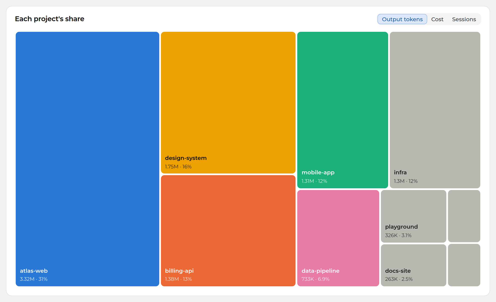
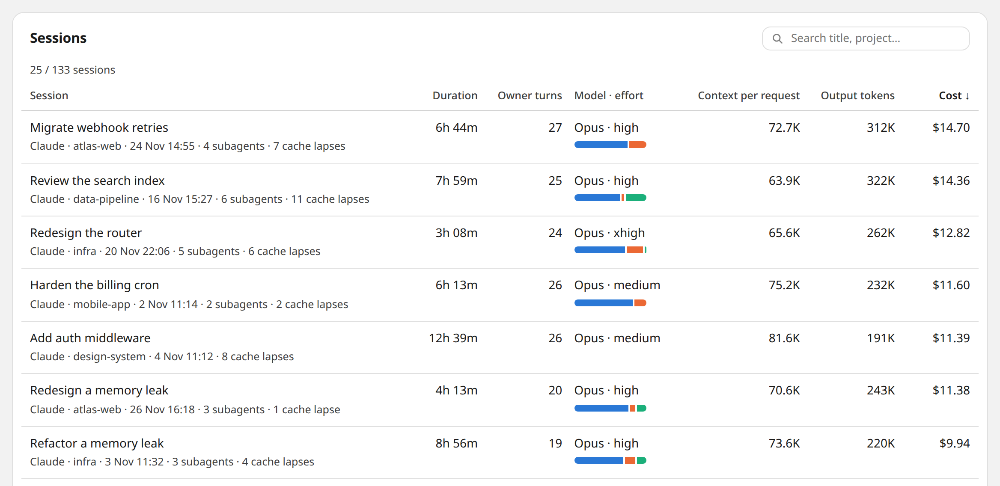

<div align="center">

<picture>
  <source media="(prefers-color-scheme: dark)" srcset="https://raw.githubusercontent.com/nguyencanhtrung/llmtop/main/docs/brand/svg/llmtop-lockup-reversed.svg">
  
</picture>

**Local usage and cost analytics for Claude Code, Codex and Antigravity**

[](https://www.npmjs.com/package/llmtop)
[](https://github.com/nguyencanhtrung/llmtop/blob/main/package.json)
[](https://github.com/nguyencanhtrung/llmtop/blob/main/LICENSE)

<picture>
  <source media="(prefers-color-scheme: dark)" srcset="https://raw.githubusercontent.com/nguyencanhtrung/llmtop/main/docs/assets/overview-dark.png">
  
</picture>

<sub>Synthetic multi-provider demo data served by <code>make demo</code>.</sub>

</div>

## Quickstart

```bash
npm install -g llmtop
llmtop serve
```

Or run without installing: `npx llmtop serve`. Open <http://localhost:4310>.

- **Local-only:** Binds `127.0.0.1` only; zero telemetry, zero background network requests (only `llmtop update` contacts npmjs when invoked), zero runtime npm dependencies.
- **Zero setup:** Automatically reads `~/.claude/projects`, `~/.codex/sessions`, and `~/.gemini/antigravity-cli`, skipping absent tools.
- **Persistent archive:** Copies transcripts into append-only `.jsonl.zst` frames and indexes them into SQLite (`node:sqlite`) under `~/.config/llmtop/data/`. Requires **Node.js 22.15+**.

## Views

- **Overview & Projects:** Cost, output tokens, cache savings, speed, daily splits (model / provider / project / effort), and Git-aware project treemap.
- **Models & Subagents:** Request behavior, effort comparisons, and main-thread vs. delegated subagent work across providers.
- **Activity & Cache:** Working hours heatmap, tool calls, skill sources, and prompt cache rebuilds by cause (`start`, `compaction`, `idle`, `other`).
- **Context & Sessions:** Pre/post-compaction context cost, counterfactual compaction replay, and sortable bilingual (EN/VI) session explorer.

<details>
<summary><strong>More screenshots (light &amp; dark)</strong></summary>

<p align="center">
  <picture>
    <source media="(prefers-color-scheme: dark)" srcset="https://raw.githubusercontent.com/nguyencanhtrung/llmtop/main/docs/assets/models-dark.png">
    
  </picture>
  <br><sub>Main thread and subagent breakdown across providers.</sub>
</p>

<p align="center">
  <picture>
    <source media="(prefers-color-scheme: dark)" srcset="https://raw.githubusercontent.com/nguyencanhtrung/llmtop/main/docs/assets/treemap-dark.png">
    
  </picture>
  <br><sub>Repository cost share treemap.</sub>
</p>

<p align="center">
  <picture>
    <source media="(prefers-color-scheme: dark)" srcset="https://raw.githubusercontent.com/nguyencanhtrung/llmtop/main/docs/assets/cache-dark.png">
    
  </picture>
  <br><sub>Prompt cache rebuilds by cause and extra cost.</sub>
</p>

<p align="center">
  <picture>
    <source media="(prefers-color-scheme: dark)" srcset="https://raw.githubusercontent.com/nguyencanhtrung/llmtop/main/docs/assets/context-dark.png">
    
  </picture>
  <br><sub>Compaction threshold replay.</sub>
</p>

<p align="center">
  <picture>
    <source media="(prefers-color-scheme: dark)" srcset="https://raw.githubusercontent.com/nguyencanhtrung/llmtop/main/docs/assets/sessions-dark.png">
    
  </picture>
  <br><sub>Sortable session explorer.</sub>
</p>

</details>

## CLI

CLI and dashboard totals stay identical for the same window and filters (`--json` supported on listing commands).

```bash
llmtop serve [--port n]                   # Dashboard at http://localhost:4310
llmtop stop                               # Stop the running dashboard server
llmtop scan                               # Archive new transcript lines into usage.db
llmtop usage [--days n | --since d --until d] [--by day|model|provider|effort|project|session|hour|tool|skill|subagent]
             [--provider name] [--project name] [--model family] [--effort level] [--json]
llmtop prices [--json]                    # Verify prices.md against host cost records
llmtop show <session>:<line>              # Print one archived record
llmtop update [--check] [--json] [--force] # Check npmjs or upgrade to the latest release
llmtop uninstall [--purge] [--dry-run] [--yes]
                                          # Stop llmtop and remove the global installation
llmtop --help | --version
```

## Update & Uninstall

```bash
llmtop update --check          # Check npmjs for a newer release (supports --json)
llmtop update                  # Upgrade the global installation to the latest release
llmtop stop                    # Stop a running llmtop serve process
llmtop uninstall --dry-run     # Preview what uninstall will stop, remove, or keep
llmtop uninstall               # Stop llmtop and remove the global package (keeps ~/.config/llmtop)
llmtop uninstall --purge       # Also remove ~/.config/llmtop (config, archive, and usage.db)
```

- **`llmtop update`** queries `registry.npmjs.org` only when invoked (never in the background), detects your global package manager (`npm`, `pnpm`, `yarn`, or `bun`), and warns if `llmtop serve` is running so you can restart it afterward. From a local Git checkout or `npx`, it prints manual steps unless `--force` is passed.
- **`llmtop uninstall`** stops running `llmtop serve` processes, removes the global package, and asks for confirmation in interactive terminals (pass `--yes` or `-y` in scripts). By default it keeps `~/.config/llmtop`; add `--purge` to delete local config, archive, and SQLite data. Original provider transcripts (`~/.claude`, `~/.codex`, `~/.gemini/antigravity-cli`) are never touched.

## Configuration

Optional settings live in `~/.config/llmtop/config.json` (see [llmtop.config.example.json](https://github.com/nguyencanhtrung/llmtop/blob/main/llmtop.config.example.json)). Override paths with `XDG_CONFIG_HOME`, `LLMTOP_CONFIG`, or `LLMTOP_DATA`. Token rates come from [prices.md](https://github.com/nguyencanhtrung/llmtop/blob/main/prices.md).

## Development

```bash
git clone https://github.com/nguyencanhtrung/llmtop.git && cd llmtop
make start        # Build dashboard and serve at http://localhost:4310 (make stop to end)
make demo         # Serve 10 weeks of synthetic data at http://localhost:4311
make test         # Run node --test suite (make check / make build / make screenshots)
```

See [CONTRIBUTING.md](https://github.com/nguyencanhtrung/llmtop/blob/main/CONTRIBUTING.md) and [docs/brand/README.md](https://github.com/nguyencanhtrung/llmtop/blob/main/docs/brand/README.md). [MIT License](https://github.com/nguyencanhtrung/llmtop/blob/main/LICENSE).
